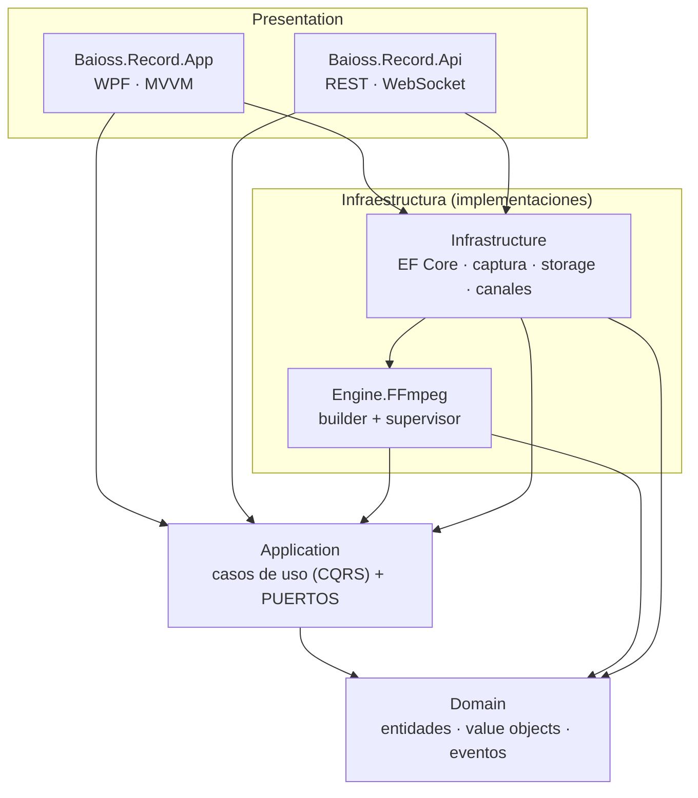
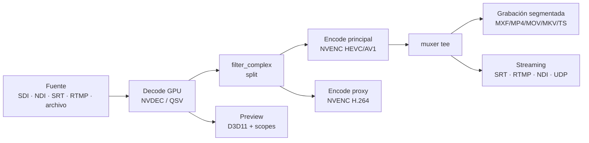

# 01 · Arquitectura

## Principios

1. **Clean Architecture** — la regla de dependencias apunta hacia el dominio. La UI, FFmpeg,
   la base de datos y la red son detalles intercambiables detrás de interfaces (puertos).
2. **Modularidad por interfaces** — cada módulo (Captura, Grabación, Preview, Streaming,
   Almacenamiento, Scheduler, Monitoreo, Metadata, FFmpeg, DeckLink, NDI, SRT, API, Auth)
   se define como un puerto en `Application` y se implementa en una capa externa.
3. **Aislamiento por canal** — cada canal es una unidad autónoma (proceso FFmpeg + watchdog +
   sesión propios). No comparten estado mutable: A y B escalan y fallan de forma independiente.
4. **CQRS donde aporta** — comandos (mutación) y queries (lectura) separados; la API y la UI
   despachan los mismos casos de uso.
5. **Estabilidad 24/7 primero** — toda ruta crítica asume reinicios, pérdida de señal y
   cortes de energía como estados normales, no como excepciones.

## Capas y regla de dependencias

`Domain` no referencia nada. `Application` solo referencia `Domain`. Las capas externas
implementan los puertos de `Application` y se inyectan por DI en el composition root (`App`).

## Mapa de módulos → puertos → implementación

| Módulo | Puerto (Application) | Implementación |
|--------|----------------------|----------------|
| Core / Orquestación | `IChannelEngine`, `IChannelManager` | `Infrastructure/Channels/*` |
| Capture | `ICaptureSource`, `ICaptureSourceFactory`, `IDeviceEnumerator` | `Infrastructure/Capture/*` (DeckLink, NDI, SRT, RTMP, File, DShow) |
| Signal | `ISignalMonitor` | `Infrastructure/Capture/SignalMonitor` |
| Recording | `IRecorderEngine`, `ISegmenter`, `ISnapshotService`, `IProxyGenerator` | `Engine.FFmpeg/*` |
| Preview | `IPreviewEngine` | `Infrastructure/Preview` (D3D11 + scopes FFmpeg) |
| Streaming | `IStreamingPublisher`, `IStreamingPublisherFactory` | rama `tee` del proceso FFmpeg |
| Storage | `IStorageManager` | `Infrastructure/Storage/StorageManager` |
| Scheduler | `ISchedulerService` | `Infrastructure/Scheduling` (BackgroundService) |
| Monitoring | `IPerformanceMonitor` | `Infrastructure/Monitoring` (NVML/PDH) |
| Metadata | `IMetadataExporter` | `Infrastructure/Metadata` (XML/JSON/CSV) |
| FFmpeg Engine | `IFfmpegLocator` | `Engine.FFmpeg` |
| Persistence | `IRepository<T>`, `IUnitOfWork` | `Infrastructure/Persistence` (EF Core) |
| API | (host) | `Api/ApiEndpoints` |
| Auth | `IAuthenticationService`, `IAuthorizationPolicy` | `Infrastructure/Security` |
| Eventos | `IEventBus` | `Infrastructure/Messaging` (canal in-process → WebSocket) |

## Pipeline interno de un canal

Un único proceso FFmpeg por canal hace decode → split → encode → grabación + streaming
**simultáneos** (muxer `tee`), más el proxy como salida adicional. El preview corre por una
ruta de baja latencia separada para no acoplar su cadencia a la del encoder de grabación.

**Entradas de red (SRT/RTMP) y relevo sin corte.** Grabar y Detener reconstruyen el proceso del canal. Con un
dispositivo abierto directamente por ese proceso (DirectShow; DeckLink sin relé) eso obliga a cerrar el proceso viejo
antes de abrir el nuevo (una sola apertura).
Con una entrada de red, en cambio, un `NetworkStreamReceiver` permanente mantiene la conexión con el emisor y empuja
el MPEG-TS a un `NetworkStreamRelay` loopback que lo reparte a varios consumidores con una ventana de pre-roll desde un
fotograma clave: el emisor nunca ve un corte y la grabación empieza unos segundos antes del botón. Sobre ese relé el
motor (`FfmpegChannelEngine`) hace el **relevo**: arranca el proceso nuevo mientras el viejo sigue pintando, el preview
del nuevo se salta el pre-roll (que la grabación sí conserva), y solo le cede la imagen cuando su preview alcanza al del
viejo: el relé numera los frames que reparte y cada reserva sabe el número del primero de su pre-roll, así que el motor sabe
qué frame de la fuente enseña cada uno (ver «Relevo sin salto atrás»); entonces retira el viejo (si grababa, finaliza su
archivo). Resultado: ni congelación ni avance rápido al Grabar/Detener (`NetworkPreviewContinuityTests` lo mide con el motor
real y un emisor RTMP local; `PreviewHandoverTests`, frame a frame).

**Audio con otro reloj (relé de red).** Algunos servidores RTMP marcan el audio con un reloj distinto del vídeo (vistos: 3,4 h y
3056 s «por delante», y el desfase cambia en cada conexión). `TsAudioClockAligner` lo detecta por el primer par (más de 10 s),
retiene el flujo 2,5 s y mide, por ORDEN DE LLEGADA, cuánto va cada PES de audio por delante del último vídeo llegado; resta la
mediana y luego un servo lento sigue la deriva. Esa premisa (el audio que llega tras un vídeo es de ese vídeo) exige que el
receptor entregue cada trama de audio en cuanto la recibe: con sus opciones por defecto, el muxer MPEG-TS de FFmpeg junta
tramas AAC en un PES hasta ~2,9 KB o media `muxdelay` (8 tramas a 135 kb/s, y hasta 350 ms de silencio), lo suelta al llenarse
con el PTS de la primera, y el intercalado por DTS lo retenía 50 ms más; el relé veía el audio menos adelantado de lo que iba y
lo colocaba tarde: 0,27 s con el servidor RTMP real y 0,47 s con el emisor de las pruebas (medido el 2026-10-19). El receptor
lleva ahora `-pes_payload_size 0 -muxdelay 0 -max_interleave_delta 1`: una trama por PES, que sale cuando llega la siguiente
(queda ~1 trama de espera en cada cola, ~42 ms con AAC a 48 kHz; en el servidor real, el relé mide 21 ms menos que el orden de
llegada). `NetworkInputTests` lo mide en lo grabado con un destello y un pitido a la vez: con relojes coherentes, 0 ms; con el
audio en otro reloj, +117 ms (antes, +467 ms), de los que ~65 ms son del propio emisor (el codificador AAC entrega cada trama
después de tener la siguiente).

**SEÑAL OK de una SRT en cuanto se describe (2026-10-20).** Una fuente de red pasa a SEÑAL OK cuando su receptor vuelca la
descripción de la entrada («Input #0 …» y sus pistas, ver `FfmpegInputDump`), y FFmpeg la vuelca al acabar su análisis. Con
MPEG-TS ese análisis no acababa nunca antes de tiempo: el CLI de FFmpeg pone `scan_all_pmts=1` en toda entrada que no lo diga, y
con eso el TS cuenta como formato sin cabecera (podría aparecer otra pista) hasta agotar `analyzeduration` (5 s de flujo; 7 s si
alguna pista sigue sin describir) o `probesize` (5 MB). La SRT real (HEVC 1080p29.97 + AAC, GOP 2 s) daba SEÑAL OK a los ~6,2 s
y a los ~7,1 s tras cada corte; y con un GOP de 8–10 s (250 frames, lo de x264 y OBS por defecto) el primer fotograma clave
llegaba después del tope y la señal salía SIN resolución («unspecified size»), igual que a 15–20 Mb/s con GOP de más de 2–3 s,
porque los 5 MB se acababan antes. El receptor SRT abre ahora la entrada con `-f mpegts -scan_all_pmts 0 -analyzeduration
12000000 -probesize 64000000` (`NetworkStreamReceiver.SrtAnalysisArguments`): el análisis acaba en cuanto cada pista está
descrita —el primer fotograma clave, 20 frames con marca de tiempo y una trama de audio decodificada— y 12 s y 64 MB quedan como
tope para lo que no se deja describir antes. `-f mpegts` porque `-scan_all_pmts` es del demuxer MPEG-TS y el CLI aborta ante una
opción de entrada que nadie usa. RTMP no cambia: la cabecera FLV anuncia sus pistas y FFmpeg acaba en cuanto las describe
(0,2–1,9 s con el servidor real). Medido con el receptor solo y un emisor SRT local que entra justo detrás de un fotograma clave
(el peor momento, salvo donde se dice):

| Emisor | Antes | Ahora |
|--------|-------|-------|
| HEVC 1080p29.97 + AAC, GOP 2 s | 5,7 s | 2,5 s |
| el mismo, con el fotograma clave al conectar | 5,6 s | 1,3 s |
| HEVC, GOP 4 s / 8 s / 10 s | 5,7 s / 6,8 s y 6,9 s **sin resolución** | 4,4 s / 8,2 s / 10,2 s |
| H.264 1080i TFF, GOP 2 s · MPEG-2 1080i, GOP 0,5 s | 4,2 s · 2,8 s | 2,8 s · 1,0 s, los dos con su «top first» |
| H.264 1080p a 20 Mb/s, GOP 4 s | 2,9 s **sin resolución** | 4,7 s |
| HEVC GOP 2 s con el audio 3 s tarde · solo vídeo | 6,7 s · 6,8 s | 3,7 s (con el audio descrito) · 2,5 s |

Con el canal entero (`NetworkInputTests.SrtListen_LocksAsSoonAsTheStreamIsDescribed_AlsoAfterACut`, 640×360, igual en la primera
conexión y al volver el emisor tras un corte): GOP 2 s, SEÑAL OK a los 2,2–2,3 s y el primer cuadro de preview a los 2,8–2,9 s
(con los argumentos de antes, 5,3–5,4 s y 5,4–5,5 s); GOP 8 s, 8,0 s con el formato (antes, 7,2 s sin él). El proceso del canal
sigue con sus 2 s de análisis (`ConsumerArgumentsFor`): en la primera conexión el relé aún no tiene sus 2,5 s de pre-roll, pero
ese primer proceso recibe también el audio que el receptor leyó antes del fotograma clave y su análisis se completa al momento;
sin audio espera 2 s de vídeo en directo (solo vídeo: SEÑAL OK a los 2,3 s y preview a los 4,4 s). Con la SRT real
(`LiveNetworkSourceTests`, 2026-10-20 10:10, todo en verde): SEÑAL OK a los 1,9 s con el formato entero (antes, ~6,2 s); tras
matar el receptor, otra vez a los 2,9 s con el segundo de espera del supervisor incluido (antes, ~7,1 s); tras un hipo de 6 s
—el servidor corta—, 2,2 s después de perder la señal. Lo que se pierde en un corte no cambia (2,9 s; antes, ~2,6 s): lo marcan
la reconexión y el siguiente fotograma clave, no el análisis, cuyos paquetes el receptor entrega igualmente. Lo que no se deja describir
nunca espera el tope entero (ver el párrafo siguiente).

**Una pista de audio que no trae datos (2026-10-20).** Si la PMT de una SRT anuncia una pista de audio que nunca manda paquetes,
el análisis acaba con ella sin parámetros («Could not find codec parameters for stream 1 (Audio: aac …, 0 channels)»). El
receptor copiaba siempre la primera pista de audio (`-map 0:a:0?`), y sin frecuencia de muestreo no hay cabecera que escribir: el
muxer fallaba («sample rate not set» → «Could not write header»), FFmpeg moría en el acto tras volcar la entrada —con la fuente
ya en SEÑAL OK y con audio— y el supervisor lo relanzaba; la señal parpadeaba unos milisegundos cada vez y el canal nunca recibía
vídeo (a los 7 s con el análisis de antes, a los 12 con el de ahora). El receptor copia ahora la primera pista de audio solo si
FFmpeg la describió (`NetworkStreamReceiver.AudioMapArguments`): `-map 0:a:u:?` toma las pistas de audio usables (el
especificador «u» de FFmpeg: con frecuencia, canales y formato de muestra; en FFmpeg 8.0 cierra el especificador y no admite
índice: `0:a:u:0?` aborta con «Trailing garbage after stream specifier») y los mapeos negativos `-map -0:a:1` … `-0:a:15` quitan
las demás pistas de audio de la entrada, así que al relé sigue llegando como mucho la primera, como siempre (el relé y el proceso
del canal cuentan con un único audio, el PID 0x101). `FfmpegInputDump` aplica la misma regla
(`FfmpegLogLines.IsDescribedAudioStream`): la fuente da SEÑAL OK sin audio, el canal pinta y graba el vídeo y el registro dice
que el emisor anuncia una pista de audio sin datos. Todo en el mismo proceso: relanzar el receptor mapeando solo el vídeo
obligaría a un segundo análisis que volvería a esperar a la pista muda hasta el tope, porque el análisis espera a todas las
pistas de la PMT, mapeadas o no (medido: con `-map 0:v:0` solo, el volcado llega igual a los 14,4 s). Medido con el receptor
solo, FFmpeg 8.0 y un emisor SRT local 640×360 que entra justo detrás de un fotograma clave (GOP 2 s):

| Emisor | Antes | Ahora |
|--------|-------|-------|
| HEVC o H.264 con su pista de audio sin paquetes | volcado a los 14,4 s y FFmpeg muere (−22) sin entregar nada | 14,4 s, solo vídeo |
| dos pistas de audio, la primera sin paquetes | 12,6 s y muere | 12,6 s, solo vídeo |
| audio normal · 3 s tarde · solo vídeo · dos pistas · la segunda sin paquetes | 2,6 · 3,9 · 2,6 · 2,7 · 12,6 s | igual, y lo mismo en el relé (el vídeo y la primera pista de audio) |

Con el canal entero (`NetworkInputTests.SrtListen_WithAnAudioTrackThatNeverCarriesData_LocksWithoutAudio_AndPaintsAndRecordsTheVideo`,
H.264 640×360 con el fotograma clave al conectar, FFmpeg 8.0): SEÑAL OK sin audio a los 12,0 s, el primer cuadro de preview a
los 12,3 s (el receptor suelta de golpe los 12 s que retuvo en el análisis, así que el relé ya tiene su pre-roll y el análisis de
2 s del proceso del canal se completa al momento) y la grabación con el vídeo y sin pista de audio; con el receptor de antes,
SEÑAL OK con audio a los 12,0 s, y el receptor muere en ese mismo instante (en el banco, el fallo de la cabecera llega en el
mismo milisegundo que el volcado). Lo que no cambia: un emisor así da SEÑAL OK al agotar el análisis, 12 s después de su primer
fotograma clave, y si su audio empezara a llegar más tarde, esa conexión sigue sin él.

**DeckLink: dispositivo persistente con relé en crudo.** La tarjeta es exclusiva y reabrirla cuesta 0,3–1 s sin frames
(más con autodetección; con el conector bidireccional de la Duo 2, la resincronización del receptor SDI), así que con la
captura directa cada Grabar/Detener congelaba el preview y grababa unas décimas de negro al principio. Desde 2026-09-27
(`Capture:DecklinkRelay`, activado por defecto) un `RawCaptureReceiver` permanente abre la tarjeta una sola vez
(`-f decklink … -c copy -f nut`) y empuja la señal EN CRUDO (el vídeo tal cual lo entrega la tarjeta y el PCM, con sus
marcas de tiempo, en un contenedor NUT) a un `RawStreamRelay` loopback; el proceso del canal la lee de ahí
(`-f nut -i tcp://127.0.0.1:…`) y el motor aplica el relevo de las entradas de red (sin pre-roll: el nuevo toma el preview en
cuanto alcanza al viejo, ver «Relevo sin salto atrás» más abajo). Diferencias con el relé
de red: el flujo son 100–250 MB/s por canal, así que se trocea con `NutStreamReader` en unidades enteras (paquetes y
frames) que se reparten por referencia desde un pool (un frame de 4 MB no se copia por consumidor ni se reserva en el
heap grande); un consumidor nuevo recibe primero las cabeceras del flujo y arranca en el siguiente punto de sincronía
tras conectar (sin pre-roll: en crudo cada frame es clave, y un atraso acumulado mientras el proceso arranca serían
decenas de MB que digerir); «al día» es un atraso de como mucho dos frames (con escrituras de 4 MB, «nada pendiente» no
se da ni en tiempo real); y un consumidor atascado pierde frames enteros (su cola se acota en bytes), nunca la
sincronía. La señal la dicta el receptor a partir del stderr de FFmpeg: abriendo la tarjeta → abierta con el formato
real → sin señal en la entrada («No input signal detected» / «Input returned», ahora detectados en caliente) / tarjeta
en uso / sin detección / reabriendo. El sondeo de recuperación del slate usa `ICaptureSource.BuildProbeArguments` (lee
del relé sin reservar consumidor y solo si el receptor ve señal). Si el proceso de captura muere, el relé cierra a los
consumidores (EOF), el supervisor lo relanza y el canal se recupera solo; el bucle de espera de señal del motor se
despierta en cuanto la fuente pasa a SEÑAL OK (antes tardaba hasta 5 s). Medido con una tarjeta sintética (lavfi en
tiempo real) en `DecklinkRelayContinuityTests`: Grabar/Detener sin ningún hueco de preview y sin reabrir la tarjeta,
caída del proceso de captura con recuperación sola, 1080p con 8 canales de audio, y con `BAIOSS_RELAY_PERF=1` el coste
del relé: 1 GB de NUT de 1080p25 a doble velocidad de tarjeta (207 MB/s) sin descartar nada, 0,19 núcleos por canal
a tiempo real con origen y consumidor incluidos (i5-10300H). Coste de los procesos, medido con un flujo 1080i59.94
uyvy422 + 16 canales (120 MB/s): receptor `-c copy -f nut` 0,10 núcleos y 18 MB; demultiplexar NUT en el proceso del
canal 0,03 núcleos (menos que leer del disco). En total unos 0,25 núcleos y 40 MB más por canal 1080i que la captura
directa, sin GPU ni disco; 4 canales son ≈ 1 núcleo y 0,5 GB/s de loopback. Validado con la Duo 2 real el
2026-09-27: 4 canales con 16 canales de audio grabando a 30/30 fps sin descartes y sin que ningún receptor se relance.
`Capture:DecklinkRelay=false` devuelve la captura directa. **Tarjeta muda:** el vigilante del supervisor no ve una tarjeta
que deja de entregar frames (FFmpeg sigue imprimiendo su progreso con el contador parado); lo hace `FrameFlowWatch` en el
receptor, contando los frames que cruzan el relé por conexión: 30 s sin ninguno, tras haber fluido y con la tarjeta abierta
y con señal, reabre la captura como tras una caída. Y como la fuente en modo relé publica su señal
(`SelfReportsRecovery`), el motor no sondea la tarjeta en carta de ajuste y, si el proceso de grabación cae con la señal
presente, reconstruye la fuente viva en vez de grabar barras. Si un relé tiene que descartar datos de un proceso que no da
abasto, el canal lo sabe (`ICaptureSource.InputDataDropped`): alarma «Frames perdidos» y un error en el registro.
(Auditoría de estabilidad 2026-09, `docs/AUDITORIA-ESTABILIDAD-2026-09.md`.)

**Relevo sin salto atrás (2026-10-19).** Con el mando en el primer frame del proceso nuevo, el preview de una DeckLink saltaba
atrás en cada Grabar y Detener y volvía a pasar por los mismos frames: 4–5 con x264 y 8–10 al Grabar con NVENC, que abre la GPU
(«es como que retrocede y vuelve al mismo frame»). El proceso nuevo empieza en el frame que pasaba al conectarse al relé, pero
tarda 0,1–0,3 s en sacarlo mientras el viejo sigue enseñando frames más nuevos, y luego digiere de golpe lo que esperaba en su
socket. Ahora el viejo sigue pintando hasta que el nuevo enseña un frame de la fuente posterior al último que se vio (con el
mismo, toma el mando sin repetirlo): el relé dice qué frame del flujo fue el primero de cada consumidor
(`RelayReservation.FirstVideoFrame`, por `ICaptureSource.NewestConsumerFirstVideoFrame`) y el motor cuenta los frames que saca
cada proceso. Los dos pierden igual el primero al unirse a mitad del flujo, así que entre ellos la comparación es exacta. Sin
saber qué frame enseña cada uno (carta de ajuste), con el viejo parado (250 ms sin frames) o si el nuevo no lo alcanza en
0,5 s, el relevo se hace como antes, con el frame que llega (`PreviewTakeover`). El tope es corto a propósito: un
proceso que graba un preset que la CPU no codifica a tiempo real no alcanza nunca al viejo, y esperarle con los dos en marcha
solo le quita CPU (con 2 s, un ProRes 422 HQ 1080p59.94 que va justo en la DeckLink acabó con descartes del relé).
`PreviewHandoverTests` lo mide con una DeckLink sintética que lleva el número de cada frame en la imagen (ocho franjas, una por
bit) y el relé como reloj del directo: antes, 4–10 frames repetidos por cambio; ahora ninguno en 12 cambios con x264 y NVENC, el
preview a 1–2 frames del directo como siempre y el cambio 7–57 ms después del primer frame del proceso nuevo (0–90 ms en la
DeckLink con TV en directo).

**El mismo relevo con el relé de red (2026-10-20).** Antes, con una entrada de red, el motor esperaba a que el proceso nuevo
fuera al día un segundo seguido y a cadencia real: con una fuente regular (la SRT real) Detener tardaba 1,7–2 s, y con una RTMP
real que llega a ráfagas (8–18 frames juntos y luego hasta 0,9 s sin nada, por el servidor) cada ráfaga reiniciaba la cuenta o
rompía la cadencia y Detener tardaba 2–6 s, con la grabación siguiendo mientras tanto. Ahora el relé de red numera los frames de
vídeo que reparte y cada reserva da el número del primero de su pre-roll; el preview se salta exactamente esos frames, así que el
primero que enseña es el siguiente, y el relevo es el de arriba. Con una fuente a ráfagas, «el viejo parado» no son 250 ms sin
frames, sino lo que la fuente suele callar entre ráfagas (1,5 veces el hueco mayor reciente, hasta 2 s). Sin número (un proceso
relanzado), sigue esperando a que vaya al día. `PreviewHandoverTests` lo mide también con un emisor RTMP local con las franjas:
ningún frame repetido en 6 cambios, el preview a 15–16 frames del directo como antes (la decodificación) y Detener en 0,8 s.

**Alarma «Frames perdidos» (2026-10).** El contador `drop_frames` del progreso de FFmpeg no sirve tal cual: (1) cuenta
también los frames que FFmpeg tira A PROPÓSITO cuando el preset fija una cadencia menor que la de la fuente (`-r`: de 30 a
25 fps, 5 por segundo con la CPU sobrada); (2) FFmpeg ≥ 6.1 lo informa solo de la PRIMERA salida de vídeo —en el canal, el
preview en passthrough, que nunca descarta: con el FFmpeg empaquetado vale siempre 0— y FFmpeg ≤ 6.0, que el cliente puede
traer, lo suma de todas, conversión de la grabación incluida (la falsa alarma); (3) una saturación real casi nunca lo sube
(medido: 1080p60 en x265 va a 0,55–0,73x con 0 descartes). `SaturationDetector` (Application) decide por muestra: descartes
por encima de lo que explica la conversión (`FrameRateConversion`, por frame de ENTRADA: el `frame` del progreso es el del
preview) más un margen de fase, y, con fuentes que entregan a ritmo de tiempo real (`ICaptureSource.DeliversInRealTime`:
DeckLink, archivo con `-re`), velocidad media (tiempo de medios ÷ pared) de 8 muestras con avance por debajo de 0,85x; la
racha de `DropAlarmTracker` (3 para encender, 5 para apagar). Siguen aparte, como pérdida segura con 10 s de retención, los
descartes del relé (`InputDataDropped`) y los del dispositivo que abre el proceso del canal («Decklink input buffer
overrun!», «real-time buffer … frame dropped!» de DirectShow → `FfmpegChannelEngine.InputOverrun`). El panel, la API y el
registro de salud muestran como «perdidos» solo los que la conversión no explica; el pre-vuelo avisa de la conversión en el
registro y el panel la enseña en ámbar (CADENCIA). Pruebas: `SaturationDetectorTests`, `FrameRateConversionTests`,
integración `FrameDropAlarmTests` (30→25 sin alarma y archivo a 25; 1080p60→x265 con alarma; contadores reales con la
conversión incluida, donde la regla antigua saltaba).

**Cuánto tarda Detener (y dónde mirar).** Con relevo, Detener espera a que el preview nuevo tome el mando, en cuanto el
preview del proceso nuevo alcanza al del viejo (ver «Relevo sin salto atrás»): con el relé en crudo de DeckLink, unas décimas
después de su primer frame (Detener ≈ 0,3–0,6 s; antes esperaba un «al día sostenido» y en producción, con 4 canales
grabando, tardaba 15 s); con una entrada de red, cuando el proceso nuevo ha digerido su pre-roll (Detener ≈ 0,8 s con un
emisor RTMP local; antes, 1 s de directo confirmado + 0,5 s de cadencia: 1,7–2 s, y 2–6 s con una RTMP a ráfagas). Sin
saber qué frame enseña cada uno, una entrada con pre-roll (`ICaptureSource.DeliversPreroll`) espera aún al «al día
sostenido» (hasta 10 s de `SettleTimeout` o 15 s de `HandoffTimeout` si la máquina va saturada).
Luego le cierra la ENTRADA al grabador: con un relé (DeckLink, red) el relé le escribe lo
que ya tenía en cola y le cierra su socket (`RelayReservation.EndInput`, tomada para ese proceso al construirlo:
`ICaptureSource.NewestConsumerEndInput`), y con NDI el receptor le cierra sus dos entradas; FFmpeg termina solo (EOF) con todo
lo que le llegó. Las fuentes que el proceso abre él mismo (DirectShow, DeckLink sin relé, archivo), la carta de ajuste y un
FFmpeg que no sale en 5 s tras el fin de flujo reciben la «q», que FFmpeg 8.0 solo mira una vez por `-stats_period` (1 s):
hasta 1 s más de grabación y de espera, y lo que esperaba en el socket no llega al archivo. Medido en la DeckLink con señal de
TV (`StopTailMeasurementTests`, H.264 1080i MP4, 10 Detener de cada): el archivo se cierra en 0,18–0,36 s en vez de 0,42–1,33 s,
Detener tarda 0,47–0,67 s en vez de 0,79–1,67 s, el archivo deja de grabar en el instante en que se le cierra la entrada (antes,
hasta 1,00 s después) y FFmpeg lee todo lo que el relé le escribió (con la «q», los 1–2 últimos frames se quedaban en el socket).
Con un preset que lleva la máquina al límite, el proceso que graba va unas décimas por detrás del directo y Detener espera a
que codifique ese atraso en vez de tirarlo (ProRes 422 HQ 1080p59.94: cierre 1,2–1,6 s). Después espera a que FFmpeg cierre el archivo (hasta
`GracefulTimeout`, 30 s; si vence, lo mata y avisa «FFmpeg no finalizó en…»), emite el segmento, espera su fila en la
BD y publica `RecordingStopped` (el bus solo encola para la auditoría y para cada panel web: desde 2026-09 cada WebSocket
tiene su cola y su escritor, y un panel lento ya no alarga el Detener). El diálogo del nombre se abre al instante y el
renombrado espera a que la parada termine. En el APAGADO de la aplicación, Detener cierra el archivo sin levantar un
preview nuevo ni verificarlo (el canal se dispone justo después), dentro de un tope total de 45 s. Medido con contenido fabricado (i5-10300H, GTX 1650 Ti, NVMe): el cierre del archivo en
sí NO crece con las horas (MXF MPEG-2 + PCM de 3 h y 7 GB en 0,11 s; MP4 estándar con vídeo 59.94 fps y 8 pistas AAC
de 3 h codificado con x264 en 0,10 s: el `moov` de 4 millones de muestras es cuestión de milisegundos; un archivo de
3,5 GB se cierra en 0,12 s con Defender activo), pero **el cierre de `h264_nvenc` sí**: con el mismo MP4 de 8 pistas,
FFmpeg tarda en salir 0,6 s tras 1 h de contenido, 2,2 s tras 2 h y 4,0 s tras 3 h (superlineal; con 20 s o 5 min de
contenido, 0,24 s), y ese tiempo lo espera Detener. Lo que puede alargarlo además en producción y no depende del
motor: un antivirus que escanea el archivo al cerrarlo (crece con el tamaño), SQLite bloqueada por otro escritor
(hasta 30 s) o un cliente del panel web que no lee.
Para saberlo sin adivinar, el registro deja dos líneas por cada Detener: «Canal X: relevo del preview en A s y archivo
cerrado en B s (fin de entrada | «q»)» (motor) y «Canal X: grabación detenida en T s (motor, base de datos, eventos)» (canal).

**Carta de ajuste a tiempo real.** Al perder la señal grabando con «Carta de ajuste al perder señal», el motor cambia el
proceso del canal por el de `FfmpegArgumentBuilder.BuildSlate`: barras SMPTE con el rótulo «SIN SEÑAL» y silencio (con
tantos canales como la fuente y los mismos pans), en el formato del preset y con las mismas salidas (preview, medidores y
una pieza nueva de grabación). Si el preset no fija resolución y tasa (los de fábrica sí), se toman de la señal que publica
la fuente en ese momento, y una fuente sin señal puede no publicar ninguna (NDI y las entradas de red no lo hacen nunca):
entonces la carta sale a 1080p25 y sus piezas no se unirían sin recodificar con las de la fuente (limitación conocida).
Las dos señales salen de UNA entrada lavfi a ritmo de reloj:
`-re -f lavfi -i "smptebars=…[out0];anullsrc=…[out1]"`. Sin `-re`, lavfi genera tan deprisa como codifica la máquina
(medido hasta 2026-10-13 con el FFmpeg empaquetado: 14,1–14,8× con x264 veryfast a 720p25; 10 s sin señal dejaban 147 s
de barras): una caída de minutos llenaba el disco con horas de barras, el canal en barras acaparaba la CPU de los demás
y, con una entrada con pre-roll (relevo con asentamiento), el preview no pasaba a las barras hasta el tope de 10 s porque
nunca llegaban «a cadencia real». Una sola entrada y no una por generador: con dos, FFmpeg retiene el silencio para no
adelantarse al vídeo (que sale del codificador con retraso) y al cerrar la pieza el audio acababa 0,6 s antes que el
vídeo (1,2 s sin `-re`); con una, acaba como las piezas de la fuente real (+0,07 s, un bloque de AAC).
`SlateRealTimeTests` lo comprueba con FFmpeg real: el argv (progreso = reloj + el empujón inicial de 0,5 s de `-re`,
archivo = lo que estuvo en marcha, en estéreo y con 8 canales) y el motor completo fuente → barras → fuente con un
dispositivo (sondeo de recuperación), un relé (relevo con el primer frame) y una entrada con pre-roll (relevo con
asentamiento): X s de barras = X s de archivo, el mismo formato en las tres piezas y una unión con `-f concat -c copy`
que se decodifica limpia.

**Colchón de preview (`PreviewPacer`).** El preview pinta cada frame según llega; una fuente que entrega a ráfagas
(un servidor RTMP que se para y luego descarga de golpe) se ve a saltos aunque el motor esté sano. Por eso cada
fuente de red admite un colchón opcional (Entradas → Fuentes de red → «Colchón de preview», 0 = sin colchón): los
frames se encolan tal como llegan y un hilo propio los entrega a la cadencia nominal de la fuente con ese retardo,
manteniendo el último frame en un hueco, corrigiendo la deriva con un frame repetido o descartado cada cinco entregas
fuera de una banda muerta (mitad y doble del objetivo) y acotando la cola (descarta lo más viejo) ante una ráfaga mayor
que el colchón. Está por encima de los sumideros de proceso, así que un relevo no lo vacía; y no toca la grabación.
Medido con el servidor real del usuario (paradas de hasta 1,8 s): de 27 fps con huecos a 29–30 frames por segundo
exactos con 2 s de colchón (`NetworkPreviewCushionTests`: banco con proxy a ráfagas y sonda contra una URL real). Con la RTMP
de pruebas del 2026-10-20 (ráfagas de 8–18 frames y huecos de hasta 0,9 s), 40 s por valor: sin colchón 27,9 fps con 33
paradas de más de 0,5 s y segundos de 2 a 47 frames; con 1000 ms, 29,2 fps y un hueco de 0,34 s; con 1500 ms, 30,0 fps (hueco
máximo 45 ms) pero 23 frames descartados por ráfagas mayores que el colchón; con 2000 ms, igual de fluido y 1 descartado.

## Procesos en ejecución (background services)

El host (`App` o un Windows Service en modo headless) levanta servicios de fondo:

- **ChannelEngine ×N** — orquesta cada canal.
- **SchedulerHostedService** — dispara trabajos por fecha/hora/CRON.
- **RetentionHostedService** — aplica auto-delete/archivado (7/30/90/personalizado).
- **PerformanceMonitorHostedService** — publica CPU/RAM/GPU/VRAM/Disco/Red.
- **ContinuousRecordingHostedService** — re-arma sesiones 24/7 tras reinicio del host.
- **API (Kestrel embebido)** — REST + WebSocket de eventos.

## Tecnologías transversales

- **Logging**: Serilog (sink de archivo con rolling diario; opcional Seq/Elastic en empresa).
- **Concurrencia**: `async`/`await`, `Channel<T>` para telemetría, un proceso FFmpeg por canal. La salida
  (stdout/stderr) de todo proceso hijo de larga vida se lee con `ProcessOutput` (un hilo propio por flujo), nunca con
  `Process.BeginOutputReadLine`: en Windows esas tuberías son síncronas y cada lectura «asíncrona» secuestra un hilo
  del pool mientras espera; con varios FFmpeg vivos el pool se agotaba y toda la app (preview, relé, API) se paraba
  varios segundos en cada Grabar/Detener.
- **Hardware**: NVENC/NVDEC/AV1, AMF, QuickSync vía FFmpeg; NVML para métricas de GPU.
- **Interop preview**: textura D3D11 compartida → `D3DImage` en WPF (cero copias a CPU).
