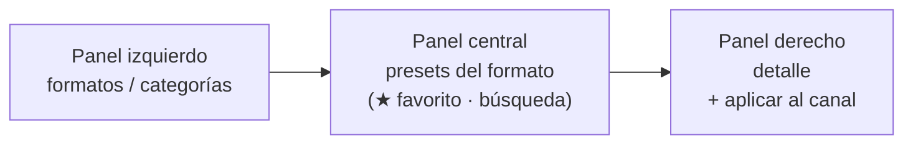
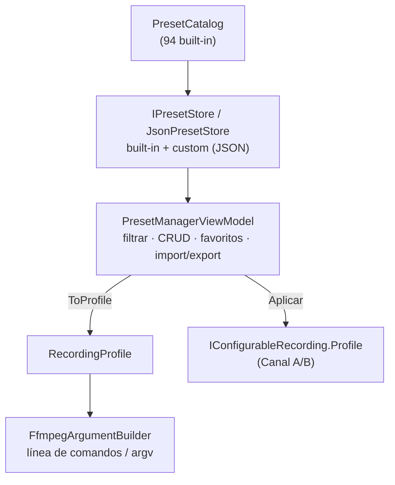

# 08 · Presets de grabación / encoding

Sistema de **presets** (formatos y perfiles preconfigurados) inspirado en Marsis Ingest: el
operador elige un formato profesional sin conocer los parámetros técnicos de FFmpeg. Cada
preset define la receta completa y **genera automáticamente su línea de comandos**.

## Interfaz de 3 paneles

Se abre desde la barra de título (**⚙ Presets de grabación**) → ventana
[`PresetManagerWindow`](../src/Baioss.Record.App/Presets/PresetManagerWindow.xaml).



- **Izquierda** — formatos: Todos, ★ Favoritos, MPEG-2, H.264, H.265/HEVC, DNxHD/DNxHR,
  ProRes, XDCAM, MXF OP1A, AVI, MKV, Audio, Streaming, Proxy, Archive.
- **Centro** — presets de la categoría, filtrados por la **búsqueda rápida**; estrella de favorito
  por fila; etiqueta "fábrica" en los built-in.
- **Derecha** — todos los parámetros del preset y un selector de **Canal A/B** con el botón *Aplicar*.
  La **línea de comandos FFmpeg** generada está oculta de fábrica; se muestra poniendo a `true`
  `UiFeatures.ShowFfmpegCommandLine` ([`UiFeatures.cs`](../src/Baioss.Record.App/UiFeatures.cs)) y recompilando.

Barra de herramientas: **Nuevo · Editar · Duplicar · Eliminar · Importar · Exportar**.

## Parámetros que define cada preset

| Parámetro | Campo | Mapeo FFmpeg |
|-----------|-------|--------------|
| Contenedor | `Container` | muxer `-f` (mp4/mov/mxf/mkv/mpegts/avi/mpeg/wav/mp3) |
| Códec de video | `VideoCodec` | `-c:v` (libx264, libx265, hevc/h264/av1_nvenc, prores_aw, dnxhd, mpeg2video) |
| Códec de audio | `AudioCodec` | `-c:a` (aac, pcm_s24le, libfdk_aac, libopus, libmp3lame, mp2) |
| Resolución | `Width`/`Height` | filtro `scale=W:H` (vacío = nativa) |
| FPS | `FrameRateNum/Den` | `-r N/D` (vacío = la de la fuente) |
| Bitrate | `VideoBitrateMbps` | `-b:v` (en DNxHD clásico elige el CID; ProRes/DNxHR lo ignoran) |
| Max bitrate | `MaxBitrateMbps` | `-maxrate` + `-bufsize` (VBV) |
| GOP | `GopSize` | `-g` |
| Pixel Format | `PixelFormat` | `-pix_fmt` (yuv420p, yuv422p, *p10le; Auto = el del códec) |
| Audio Sample Rate | `AudioSampleRate` | `-ar` |
| Audio Channels | `AudioLayout` | `-ac` (1/2/6/8) |
| Audio Bitrate | `AudioBitrateKbps` | `-b:a` |
| Field Order | `ScanType` | `setfield`/`-field_order` (tt/bb) + `-flags +ilme+ildct` (x264, MPEG-2) o `+ildct` (ProRes, DNxHD) |
| Control de tasa | `RateControl` | CBR / VBR / CRF-CQ |

> El campo `AudioOnly` produce comandos sin video (`-vn`) para los presets de la categoría Audio.

## Catálogo de fábrica (94 presets)

[`PresetCatalog`](../src/Baioss.Record.Application/Presets/PresetCatalog.cs) — todos verificados
grabando material real (ver más abajo).

| Categoría | Presets |
|-----------|---------|
| **MPEG-2** (6) | PS SD PAL · PS SD NTSC 480i59.94 · TS HD 1080i25 · TS HD 1080i59.94 · TS SD PAL · TS SD NTSC 480i59.94 |
| **H.264** (26) | **CPU (libx264):** HD 720p50 · 720p59.94 · FullHD 1080p23.98 · 1080p25 · 1080p29.97 · 1080p50 · 1080p59.94 · 1080p60 · 4K UHD 2160p50 · 2160p59.94 · **entrelazado:** 1080i25 MP4 · 1080i25 TS · 1080i59.94 MP4 · 1080i59.94 TS · SD PAL 576i25 · SD NTSC 480i59.94 · **GPU NVIDIA (NVENC):** 720p50 · 720p59.94 · 1080p23.98 · 1080p25 · 1080p29.97 · 1080p50 · 1080p59.94 · 1080p60 · 4K 2160p50 · 4K 2160p59.94 |
| **H.265/HEVC** (10) | **CPU (libx265):** FullHD 1080p25 · 1080p59.94 · 4K UHD 2160p50 10-bit · 2160p59.94 10-bit · **GPU NVIDIA (NVENC, 8 bits):** 1080p25 · 1080p29.97 · 1080p50 · 1080p59.94 · 4K 2160p50 · 4K 2160p59.94 |
| **DNxHD/DNxHR** (9) | **DNxHR (progresivo):** LB 1080p25 (offline) · SQ 1080p25 · HQ 1080p25 · HQ 1080p59.94 (MOV) · HQX 1080p25 10-bit · 444 1080p25 10-bit · **DNxHD (entrelazado):** 185 1080i25 (MXF) · 185 1080i25 (MOV) · 220 1080i59.94 (MOV) |
| **ProRes** (10) | 422 Proxy 1080p25 · 422 LT 1080p25 · 422 1080p25 · 422 HQ 1080p25 · 4444 1080p25 · 4444 XQ 1080p25 · 422 HQ 4K 2160p25 · 422 HQ 1080p59.94 · 422 HQ 1080i25 · 422 HQ 1080i59.94 |
| **XDCAM** (4) | HD422 1080i25 50 Mbps · HD 1080i25 35 Mbps · HD422 1080i59.94 50 Mbps · HD 1080i59.94 35 Mbps |
| **MXF OP1A** (14) | XDCAM HD422 50 (1080i25) · DNxHR HQ 1080p25 · **59.94 (NTSC):** XDCAM HD422 1080i59.94 · 1080p59.94 · 1080p29.97 · 1080p23.98 · 720p59.94 · 1080p60 · DNxHD 220 1080i59.94 · DNxHR HQ 1080p59.94 · DNxHR HQX 1080p59.94 10-bit · **50 Hz (PAL):** XDCAM HD422 1080p50 · 720p50 · DNxHR HQ 1080p50 |
| **AVI** (2) | H.264 1080p25 · H.264 1080i25 |
| **MKV** (3) | H.264 1080p25 · H.264 1080i25 · HEVC 4K 10-bit |
| **Audio** (3) | WAV PCM 48k 24-bit · AAC 256k (M4A) · MP3 320k |
| **Proxy** (2) | H.264 540p · H.264 360p |
| **Archive** (2) | HEVC 1080p CRF20 · ProRes 422 1080p |
| **Streaming** (3) | IPTV H.264 720p TS (UDP) · RTMP H.264 1080p · SRT H.264 1080p |

### Presets por GPU NVIDIA (NVENC)

Los **H.264 NVENC** y **HEVC NVENC** graban con el codificador de la tarjeta NVIDIA y dejan libre la CPU; el resto de
H.264/HEVC de fábrica codifica por CPU (libx264/libx265). Los H.264 NVENC son los gemelos por GPU de los H.264 de CPU:
misma resolución, cadencia, bitrate y GOP (lo comprueba `PresetCatalogTests`); todos en MP4 + AAC.

- **Solo progresivos:** NVENC no codifica entrelazado. Para 1080i/576i/480i siguen los de x264, MPEG-2, ProRes y DNxHD
  clásico (DNxHR no: el codificador de FFmpeg no admite entrelazado en sus perfiles; ver más abajo).
- **Señal entrelazada con un preset progresivo** (una DeckLink en 1080i59.94 grabando con un NVENC 1080p): la rama de
  grabación **desentrelaza** con `bwdif` antes de escalar, con el orden de campos que la tarjeta da al abrir
  (`SignalInfo.Scan`; el relé en crudo no conserva la marca en los cuadros). Si el preset dobla la cadencia (1080i59.94 →
  1080p59.94) sale un cuadro por campo. Antes se grababan los campos entretejidos en cuadros progresivos: peine en todo lo
  que se mueve.
- **8 bits:** NVENC pide `p010` para 10 bits y no acepta el `yuv420p10le` del catálogo, así que los HEVC 4K de 10 bits
  siguen siendo de CPU.
- **Píxel Auto:** el motor le entrega a NVENC `nv12`, su formato nativo, al final de la rama de grabación.
- **Driver:** lo fija la compilación de FFmpeg, que descarga el cliente (no va en el instalador). Las de SDK 13.1
  (ffmpeg-autobuild desde la del 2026-06-14, como la de `tools\ffmpeg`) piden **≥ 610**, que Turing y posteriores sí
  reciben. Maxwell, Pascal y Volta no pasan de la rama R580: usan FFmpeg 8.0 estable, de ffmpeg-stable-autobuild (SDK
  13.0, **≥ 570**; también sirve la de ffmpeg-autobuild del 2026-03-12), y no una de ffmpeg-autobuild del 2026-03-15 al
  2026-04-06, que con imagen fija o negro deja ilegibles los MP4/MOV de QuickSync. Ver [FFMPEG.md](FFMPEG.md).
- **Sin NVIDIA**, o con un driver más antiguo que el que exige la compilación de FFmpeg, el canal **degrada solo**
  (`EncoderFallbackChain`, alarma *EncoderFallback*): H.264 → QuickSync → AMF → CPU (libx264); HEVC → QuickSync
  (`hevc_qsv`) → CPU (libx265). El escalón QuickSync de HEVC importa: libx265 no llega a 1080p29.97 en tiempo real en un
  Core i7-8700 (medido con una DeckLink: 267 cuadros perdidos en 15 s), la GPU integrada sí. Lo permite el píxel Auto:
  cada codificador recibe su formato nativo, porque un `yuv420p` fijo haría fallar a `h264_qsv`. Lo cubre
  `BuildLive_CatalogNvencPresets_EveryFallbackStepGetsItsNativePixelFormat`.
- **No todo es un codificador que no abre** (`RecordingFailureDetector`): si el contenedor rechaza lo que pide el preset
  (FFmpeg no puede escribir la cabecera: AAC en MXF, PCM de 24 bits en MPEG-PS, ProRes en MP4…) o no abre un codificador
  que no es el de vídeo (el audio con un bitrate que no admite), degradar no arregla nada y una pieza nueva fallaría
  igual: la grabación se **detiene sola** con la alarma roja *RecordingFailed* (hasta la próxima grabación), el motivo en
  la auditoría (`EncoderFailed`) y la parada por error, sin dejar el archivo vacío; el preview sigue. Igual cuando el
  codificador de vídeo no abre y ya no hay a qué degradar. Antes el «Could not open encoder before EOF» del rawvideo del
  preview se tomaba por el codificador de vídeo, se degradaba en vano y, al llegar a CPU, el canal se quedaba «Grabando»
  sin proceso ni alarma. Lo cubren `MuxerRefusalTests` (FFmpeg real) y `RecordingFailureDetectorTests`.
- En la ventana de presets, escribir **NVENC** en el buscador los lista todos.

```text
# H.264 NVENC · FullHD 1080p29.97
ffmpeg ... -filter_complex "[0:v]scale=1920:1080[mainout]" -map "[mainout]" -map 0:a? \
  -c:v h264_nvenc -preset p5 -tune hq -rc cbr -b:v 16000000 -g 50 -bf 0 -no-scenecut 1 \
  -c:a aac -ar 48000 -b:a 256000 -ac 2 -r 30000/1001 ... -f mp4 -y <salida>

# HEVC NVENC · 4K UHD 2160p59.94
ffmpeg ... -filter_complex "[0:v]scale=3840:2160[mainout]" ... \
  -c:v hevc_nvenc -preset p5 -tune hq -rc vbr -b:v 45000000 -maxrate 60000000 -bufsize 120000000 -g 50 -bf 0 ...
```

### DNxHD clásico y DNxHR (Avid)

- **DNxHR** (`VideoCodec.DnxHr`): por perfil (`-profile:v dnxhr_lb/sq/hq/hqx/444`), cualquier resolución y **solo
  progresivo**: el `dnxhd` de FFmpeg rechaza la DCT entrelazada en sus perfiles («Interlaced encoding is not supported for
  DNxHR profiles»). Los antiguos presets «DNxHR HQ · 1080i…» guardaban los dos campos en cuadros progresivos (el MXF los
  declaraba progresivos; medido con una DeckLink en 1080i59.94).
- **DNxHD clásico** (`VideoCodec.DnxHd`): un CID fijo por formato (tamaño, barrido, 8/10 bits) y **el bitrate elige el
  CID**. FFmpeg busca la clave en la lista del CID sin mirar la cadencia; los Mbps reales son el tamaño de cuadro × la
  cadencia, por eso Avid llama distinto al mismo CID en 59.94i y en 50i:

  | 1920×1080i | a 29.97 (59.94i) | a 25 (50i) | CID | píxel |
  |------------|------------------|------------|-----|-------|
  | DNxHD 145 / 120 | 145 Mbps | 121 Mbps | 1242 | `yuv422p` |
  | DNxHD 220 / 185 | 220 Mbps | 183,5 Mbps | 1243 | `yuv422p` |
  | DNxHD 220x / 185x | 220 Mbps | 183,5 Mbps | 1241 | `yuv422p10le` |

  El builder emite `-profile:v dnxhd -b:v <clave> -flags +ildct` tras un `setfield`: cuadros entrelazados TFF de verdad.
  Comprobado con la DeckLink: en MXF `field_order tt`; en MOV el muxer de FFmpeg declara el entrelazado de DNxHD en el
  átomo `ARES` de Avid y no en `fiel`, así que ffprobe dice `unknown`, pero el cuadro decodificado es entrelazado TFF.
- **En AVI, con `-tag:v AVdn`** (el FourCC de Avid). Sin él, FFmpeg escribe el DNxHD clásico con FourCC 0 y el archivo se
  relee como `rawvideo`: ilegible y sin error. Con él se relee como `dnxhd` (medido con FFmpeg 8.0 y con el incluido, en
  archivo único, en segmentos y por `tee`). DNxHR no lo necesita: ya sale con `AVdh`.
- **A prueba de bitrates libres** (`FfmpegArgumentBuilder.DnxhdBitrateMbps`, con los 13 CID que el FFmpeg empaquetado
  acepta sin `-strict experimental`): una clave válida se respeta tal cual; cualquier otra —con FFmpeg sería «video
  parameters incompatible with DNxHD» y la grabación no arrancaría— se ajusta al CID cuyos Mbps reales a esa cadencia
  quedan más cerca, y sin bitrate se toma el CID de más calidad. Un DNxHD sin CID clásico (4K, SD, 4:4:4 —el `dnxhd` de
  FFmpeg no codifica DNxHD 444— o tamaño desconocido) graba DNxHR por perfil, lo que hacía antes. Detalle: FFmpeg no
  acepta «220» para el CID 1235 (1080p de 10 bits) aunque dé 220 Mbps a 29.97; el builder pide 185.
- **Un DNxHR entrelazado se graba como su DNxHD.** Los canales que aplicaron los antiguos presets guardan su copia del
  perfil (DNxHR entrelazado), igual que cualquier preset propio: el motor los graba como el DNxHD equivalente —SQ →
  145/120, HQ → 220/185, HQX → 220x/185x— sin que nadie vuelva a aplicar el preset (el badge del canal mantiene el nombre
  antiguo hasta entonces). LB y 444 no tienen equivalente entrelazado (no hay DNxHD 1080i por debajo de 145 ni DNxHD 444
  en FFmpeg) y siguen en DNxHR progresivo.
- **Presets renombrados (2026-10-16):** «DNxHR HQ · 1080i25 (MXF)» → «DNxHD 185 · 1080i25 (MXF)», «DNxHR HQ · 1080i25
  (MOV)» → «DNxHD 185 · 1080i25 (MOV)», «DNxHR HQ · 1080i59.94 (MOV)» → «DNxHD 220 · 1080i59.94 (MOV)» y «MXF OP1A · DNxHR
  HQ 1080i59.94» → «MXF OP1A · DNxHD 220 1080i59.94». Conservan el GUID del nombre anterior (`Make(..., formerName:)`), así
  que un favorito sigue en su sitio, y la misma clase de bitrate que DNxHR HQ (CID 1243, 917 504 bytes por cuadro).

```text
# DNxHD 220 · 1080i59.94 (MOV), grabando de una DeckLink
ffmpeg ... -filter_complex "[0:v]split=2[vrec][vprev];[vrec]scale=1920:1080,setfield=mode=tff,format=yuv422p[vmain];..." \
  -map [vmain] -map 0:a:0? -c:v dnxhd -profile:v dnxhd -b:v 220000000 -flags +ildct -pix_fmt yuv422p \
  -c:a aac -ar 48000 -b:a 256000 -ac 2 -r 30000/1001 -field_order tt ... -f mov -y <salida>
```

### ProRes: prores_aw, en tiempo real

`VideoCodec.ProRes` graba con **prores_aw** (antes prores_ks). En el PC de referencia (Core i7-8700, 6 núcleos/12 hilos)
prores_ks no llega a tiempo real: con los 12 hilos codifica 1080i29.97 HQ a 0,8–1,2× y Proxy/LT aún más despacio, así que
todos los presets ProRes perdían cuadros en vivo (prueba con DeckLink: 149–302 cuadros perdidos en 15 s). prores_aw hace lo
mismo a 5–6×. Medido con 240 cuadros reales de TV en directo (DeckLink, 1080i29.97, `-flags +ildct`, 12 hilos):

| Perfil | prores_aw | prores_ks | prores_aw: Mbps · PSNR | prores_ks: Mbps · PSNR |
|--------|-----------|-----------|------------------------|------------------------|
| 422 Proxy | 192 fps (6,4×) | 23 fps (0,76×) | 24,6 · 44,3 dB | 23,8 · 40,3 dB |
| 422 LT | 157 fps (5,2×) | 22 fps (0,72×) | 38,0 · 52,5 dB | 45,4 · 49,9 dB |
| 422 | 149 fps (5,0×) | 26 fps (0,87×) | 50,4 · 59,1 dB | 59,3 · 53,6 dB |
| 422 HQ | 169 fps (5,6×) | 37 fps (1,24×) | 66,5 · 64,6 dB | 76,8 · 64,4 dB |
| 4444 | 90 fps (3,0×) | 19 fps (0,64×) | 83,3 · 66,7 dB | 100,8 · 71,7 dB |
| 4444 XQ | 93 fps (3,1×) | 22 fps (0,72×) | 97,3 · 70,5 dB | 105,6 · 75,4 dB |

(SSIM ≥ 0,9992 en todos salvo Proxy: 0,9950 prores_aw, 0,9910 prores_ks. Los Mbps quedan lejos de los nominales de Apple
—HQ 1080i29.97 ≈ 220— porque ProRes es VBR y la señal de TV es blanda.) El proceso de grabación completo (filtros +
preview + codificación) sobre el mismo clip, en núcleos a tiempo real: 422 HQ 1080i29.97 ≈ 2,9 (3,2× de margen); 422 HQ
1080p59.94 desde 1080i (`bwdif`, un cuadro por campo) ≈ 5 (1,7×); 4444 XQ 1080p25 ≈ 3,4 (2,5×). prores_ks HQ, solo el
codificador: ≈ 9.

- **Perfiles:** prores_aw admite los seis con su fourcc (`apco`/`apcs`/`apcn`/`apch`/`ap4h`/`ap4x`) y la DCT entrelazada
  (`-flags +ildct`). Codifica en BFF los cuadros marcados BFF y en TFF el resto, y el MOV toma el orden de la marca del
  primer cuadro (sin marca declara `bt`): de ahí el `setfield` de la rama de grabación y de la carta de ajuste, que sin él
  salía con el contenedor en BFF (y en x264, con los cuadros en BFF). Comprobado con ffprobe: cuadros
  `interlaced_frame=1`, `top_field_first=1`.
- **Croma por perfil** (`FfmpegArgumentBuilder.ProResFormat`): prores_aw no abre un 4444/XQ con 4:2:2 (EINVAL «need
  YUV444P10 input») y con 4:4:4 convierte un 422 en 4444 por su cuenta, así que el formato de píxel lo fija el perfil
  —4444/XQ `yuv444p10le`, el resto `yuv422p10le`— y no un formato suelto del preset. Auto = 422 HQ, o 4444 si el preset
  pide 4:4:4.
- **Calidad:** de Proxy a HQ, igual o mejor PSNR que prores_ks con menos bitrate; en 4444/XQ algo menos (66–70 dB frente a
  72–75), muy por encima de lo visible. prores_aw ajusta el cuantificador por slice dentro del rango de cada perfil (HQ:
  1–6) y no impone un tope de tamaño de cuadro: con material muy complejo un archivo puede pasar del bitrate nominal antes
  que perder calidad.
- **Compatibilidad:** el flujo es ProRes estándar (mismos fourcc y cabeceras; el fabricante del cuadro dice `fmpg` en vez
  del `Lavc` de prores_ks). Los dos son implementaciones de FFmpeg, no codificadores con licencia de Apple: en eso no cambia
  nada. Verificado aquí que FFmpeg/ffprobe leen perfil y entrelazado; **no** se ha podido abrir en Final Cut, Premiere ni
  Avid (este PC no los tiene). prores_aw es el que FFmpeg registra también con el nombre genérico `prores`.
- **Descartado:** prores_ks con cuantificador fijo (`-qscale:v`) también es rápido (6,7× en HQ), pero un cuantificador fijo
  ignora la tasa del perfil (un Proxy dejaría de pesar como un Proxy) y el tamaño dependería solo del contenido.
- **Límite: 4K.** «ProRes 422 HQ · 4K 2160p25» no llega a tiempo real en el i7-8700 ni con prores_aw: desde una señal 1080i
  (desentrelazar + escalar a 4K) va a 0,73×, y solo codificar 4K HQ a 25 cuadros pide unos 6 núcleos, los seis físicos de
  esa CPU. Hace falta un procesador con más núcleos (y la Duo 2, 3G-SDI, no recibe 4K para probarlo con una fuente real).

```text
# ProRes 422 HQ · 1080i59.94
ffmpeg ... "[vrec]scale=1920:1080,setfield=mode=tff,format=yuv422p10le[vmain]" ... \
  -map [vmain] -c:v prores_aw -profile:v 3 -flags +ildct -pix_fmt yuv422p10le ... -r 30000/1001 -field_order tt -f mov ...
```

## Línea de comandos generada (ejemplos reales)

[`FfmpegCommandPreview`](../src/Baioss.Record.Engine.FFmpeg/FfmpegCommandPreview.cs) produce
exactamente lo que ejecutará el motor, con entrada/salida simbólicas:

```text
# H.264 Broadcast · FullHD 1080p25
ffmpeg -hide_banner -progress pipe:1 -stats_period 1 -i <entrada> \
  -filter_complex "[0:v]scale=1920:1080[mainout]" -map "[mainout]" -map 0:a? \
  -c:v libx264 -preset veryfast -b:v 16000000 -maxrate 16000000 -bufsize 40000000 -g 50 \
  -pix_fmt yuv420p -c:a aac -ar 48000 -b:a 256000 -ac 2 -r 25/1 \
  -af ebur128=peak=true -movflags +faststart -f mp4 -y <salida>

# XDCAM HD422 · 1080i25 50 Mbps (MXF OP1A)
ffmpeg ... -filter_complex "[0:v]scale=1920:1080,setfield=mode=tff[mainout]" ... \
  -c:v mpeg2video -b:v 50000000 -minrate 50000000 -maxrate 50000000 -bufsize 100000000 -g 12 \
  -flags +ilme+ildct -pix_fmt yuv422p -c:a pcm_s24le -ar 48000 -ac 2 -field_order tt -f mxf -y <salida>

# MXF · XDCAM HD422 1080p59.94 50 (60000/1001 progresivo)
ffmpeg ... -filter_complex "[0:v]scale=1920:1080[mainout]" -map "[mainout]" -map 0:a? \
  -c:v mpeg2video -b:v 50000000 -minrate 50000000 -maxrate 50000000 -bufsize 100000000 -g 15 \
  -pix_fmt yuv422p -c:a pcm_s24le -ar 48000 -ac 2 -r 60000/1001 -f mxf -y <salida>

# Audio · WAV PCM 48k 24-bit (solo audio)
ffmpeg ... -i <entrada> -vn -map 0:a? -c:a pcm_s24le -ar 48000 -ac 2 -af ebur128=peak=true -f wav -y <salida>
```

## Arquitectura



- [`EncodingPreset`](../src/Baioss.Record.Application/Presets/EncodingPreset.cs) — modelo plano,
  serializable a JSON; `ToProfile()` lo traduce al `RecordingProfile` de dominio.
- [`JsonPresetStore`](../src/Baioss.Record.Infrastructure/Presets/JsonPresetStore.cs) — combina los
  built-in (solo lectura) con los personalizados; persiste estos y los favoritos en
  `data/presets.json` (junto a la base de datos).
- Al **Aplicar**, el preset inyecta un `RecordingProfile` completo en el canal vía
  `IConfigurableRecording.Profile`, conservando la identidad persistida del canal.

## CRUD, favoritos e import/export

- **Nuevo / Editar / Duplicar / Eliminar** — los built-in son de solo lectura; para personalizarlos
  se **duplican** (quedan como custom editables). El editor es
  [`PresetEditorWindow`](../src/Baioss.Record.App/Presets/PresetEditorWindow.xaml).
- **Favoritos** — la estrella marca cualquier preset (incluido un built-in); se persiste.
- **Importar / Exportar JSON** — intercambio entre equipos. Estructura exportada:

```json
[
  {
    "Name": "H.264 Broadcast · FullHD 1080p25",
    "Category": "H264",
    "Container": "Mp4",
    "VideoCodec": "H264x264",
    "Width": 1920, "Height": 1080,
    "FrameRateNum": 25, "FrameRateDen": 1,
    "VideoBitrateMbps": 16, "MaxBitrateMbps": 20, "GopSize": 50,
    "PixelFormat": "Yuv420p", "ScanType": "Progressive", "RateControl": "ConstantBitrate",
    "AudioCodec": "Aac", "AudioLayout": "Stereo", "AudioSampleRate": 48000, "AudioBitrateKbps": 256
  }
]
```

Los enums se serializan como texto (estables ante reordenamientos). Al importar, cada preset
recibe una identidad nueva como personalizado.

### Presets que no podrían grabar (contenedor × códec)

[`RecordingProfileValidator`](../src/Baioss.Record.Application/Recording/RecordingProfileValidator.cs) rechaza un perfil que
FFmpeg no puede grabar: bitrate o GOP a cero, resolución impar… un **contenedor que no lleva el códec de vídeo o el de
audio** y una **frecuencia de muestreo** que el audio o el contenedor no admiten. Lo aplican el editor (al pulsar
**Aceptar**: lista los motivos y no cierra), el gestor (no **aplica** a un canal un preset propio o importado que lo
incumpla), el panel del canal (un **⚠ rojo** en el badge PRESET, con el motivo en el tooltip, si el perfil guardado del canal
no puede grabar) y el pre-vuelo de Grabar (manual, programada o por la API: aviso y auditoría «No se pudo iniciar», sin
sesión ni archivo). Los mensajes van en el idioma de la aplicación y proponen contenedores (para el vídeo), el audio que
lleva el contenedor o las frecuencias que graban.

Medido el 2026-10-18 con FFmpeg 8.0 y con el incluido (git-2026-06-14), iguales: 2 s de cada códec en cada contenedor,
releídos con `ffprobe` y una decodificación entera. *Rechaza* = el muxer no abre la salida y la grabación no arranca;
*ilegible* = FFmpeg escribe el archivo **sin error**, pero no se puede leer.

| Familia | AVI | MXF | MP4 | MOV | MKV | TS | PS |
|---|---|---|---|---|---|---|---|
| **HEVC** (x265, QuickSync, NVENC) | ilegible (FourCC 0 → `rawvideo`) | rechaza | ✓ | ✓ | ✓ | ✓ | ✓ |
| **AV1** (NVENC) | ✓ (`AV01`) | rechaza | ✓ | rechaza («only supported in MP4») | ✓ | ilegible (datos privados) | ilegible |
| **ProRes** | ✓ | ✓ | rechaza | ✓ | ✓ | ilegible (datos privados) | ilegible |
| **DNxHD/DNxHR** | ✓ (`AVdn`, `AVdh`) | ✓ | rechaza | ✓ | ✓ | ilegible (datos privados) | ilegible |
| **H.264**, **MPEG-2** | ✓ | ✓ | ✓ | ✓ | ✓ | ✓ | ✓ |

- WAV y MP3 solo llevan audio: con vídeo el muxer rechaza la pista, así que piden **Solo audio**.
- HEVC degrada dentro de HEVC (NVENC → QuickSync → libx265), así que un HEVC en AVI o MXF fallaba en cualquier equipo. AV1
  solo lo codifica av1_nvenc (NVIDIA Ada): sin ella el canal degrada a libx264 y graba H.264, pero en una Ada el mismo
  preset no graba.
- Lo cubren `RecordingProfileValidatorTests` (la matriz entera) y, con el FFmpeg real, `ContainerCodecTests` (sin la regla
  FFmpeg no deja vídeo legible; con ella el canal rechaza el perfil; lo que el mensaje propone graba).

**Audio.** Medido el 2026-10-18 con el motor real (`FfmpegChannelEngine` y el argv del producto) y FFmpeg 8.0 y el incluido:
4 s de un tono con cada códec en cada contenedor, con vídeo y en solo audio, releídos con `ffprobe` y decodificados enteros.
Los dos FFmpeg dan lo mismo salvo FDK-AAC en AVI y WAV (¹).

| Audio | AVI | MXF | MP4 | MOV | MKV | TS | PS | WAV | MP3 |
|---|---|---|---|---|---|---|---|---|---|
| **PCM** (24 bits) | ✓ | ✓ (con vídeo) | ✓ (como AAC) | ✓ (como AAC) | ✓ | ✓ (como AAC) | rechaza | ✓ | rechaza |
| **AAC** | ✓ | rechaza | ✓ | ✓ | ✓ | ✓ | rechaza | ilegible | rechaza |
| **FDK-AAC** | rechaza (¹) | rechaza | ✓ | ✓ | ✓ | ✓ | rechaza | rechaza (¹) | rechaza |
| **Opus** | rechaza | rechaza | ✓ | rechaza | ✓ | ✓ | rechaza | rechaza | rechaza |
| **MP3** | ✓ | rechaza | ✓ | ✓ | ✓ | ✓ | ✓ | ✓ | ✓ |
| **MP2** | ✓ | rechaza | ✓ | ✓ | ✓ | ✓ | ✓ | ✓ | rechaza |

- El muxer MXF solo lleva PCM (pasa el audio por `pcm_rechunk`) y necesita una pista de vídeo, la primera: en **Solo audio**
  no graba con ningún códec. El de PS solo admite MP1/MP2/MP3, AC-3, DTS y PCM de 16 bits; el MP3, solo MP3.
- PCM en MP4, MOV y TS se graba como AAC (`FfmpegCodecMap.EffectiveAudioEncoder`); en PS el motor no lo promueve.
- AAC en WAV: el WAV no delimita los paquetes y el del codificador nativo sale sin error, pero no se decodifica.
- (¹) El FDK-AAC del incluido sale en ADTS y los muxers RIFF (AVI, WAV) no lo aceptan («ADTS is only supported with codec tag
  0x1610»); FFmpeg 8.0 sí lo graba. Se rechaza en los dos: un preset no puede grabar en un equipo y en otro no.
- Sin la regla, con vídeo el muxer no escribe la cabecera, el motor lo toma por un codificador de vídeo que no abre y el canal
  se queda «Grabando» con un archivo de 0 B y sin alarma; en solo audio relanza piezas de 0 B. El mensaje propone el audio que
  el contenedor lleva con su identificador estándar: PCM en MXF y WAV; MP2 o MP3 en PS; PCM, MP3 o MP2 en AVI; AAC en MOV;
  MP3 en MP3.

**Frecuencia de muestreo.** El editor no la enseña (los presets graban a 48 kHz), pero un preset importado o editado a mano
(`AudioSampleRate` en el JSON), o el perfil guardado de un canal, puede traer otra, y el motor la pasa tal cual (`-ar`).
Medido el 2026-10-18 con el motor real y FFmpeg 8.0 y el incluido, iguales: 4 s de cada audio en cada contenedor que lo
lleva, con vídeo y en solo audio, de 7350 a 384000 Hz (y 47952 y 768000 con PCM), releídos y decodificados enteros.

| Audio (codificador) | Frecuencias que graba (Hz) |
|---|---|
| **PCM** (`pcm_s24le`) | cualquiera (medido de 10 a 768000), salvo en MXF (solo 48000) y en MP4, MOV y TS (es AAC: las de AAC) |
| **AAC** (`aac`) | 7350, 8000, 11025, 12000, 16000, 22050, 24000, 32000, 44100, 48000, 64000, 88200, 96000 |
| **FDK-AAC** (`libfdk_aac`) | las de AAC menos 7350 |
| **Opus** (`libopus`) | 8000, 12000, 16000, 24000, 48000 (el archivo declara 48000: Opus siempre decodifica a 48 kHz) |
| **MP3** (`libmp3lame`) | 8000, 11025, 12000, 16000, 22050, 24000, 32000, 44100, 48000; en MP4, de 16000 para arriba |
| **MP2** (`mp2`) | 16000, 22050, 24000, 32000, 44100, 48000, con un bitrate de la tabla de esa frecuencia |

- Con otra frecuencia el codificador no abre («Specified sample rate 44100 is not supported by the libopus encoder»). El muxer
  MXF solo implementa 48 kHz («only 48khz is implemented») y el MP4 no lleva MP3 por debajo de 16 kHz («muxing mp3 at 8000hz
  is not standard»; el MOV sí).
- AAC, FDK-AAC, Opus y MP3 ajustan solos el bitrate a lo que cabe a esa frecuencia (256 kb/s a 8 kHz graban). MP2 no: solo
  abre con los kb/s de su versión MPEG, 32, 48, 56, 64, 80, 96, 112, 128, 160, 192, 224, 256, 320 o 384 a 32, 44,1 y 48 kHz
  y 8, 16, 24, 32, 40, 48, 56, 64, 80, 96, 112, 128, 144 o 160 a 16, 22,05 y 24 kHz («bitrate 256 is not allowed in mp2»):
  un MP2 a 24 kHz con los 256 kb/s de sus presets no graba, ni uno a 48 kHz con 200.
- Sin la regla pasa lo mismo que con un audio que el contenedor no lleva: con vídeo, «Grabando» con 0 B; en solo audio,
  piezas de 0 B. El mensaje propone, de menor a mayor, las frecuencias que graban con ese audio en ese contenedor o, con
  MP2, los kb/s de esa frecuencia.
- Lo cubren `RecordingProfileValidatorTests` (cada audio en cada contenedor a 17 frecuencias, y la tabla de MP2) y, con el
  FFmpeg real, `ContainerCodecTests` (una fila por causa, sin y con la regla; una por propuesta; y que las listas del
  validador son las que declara ese FFmpeg).

## Verificación

El smoke test [`tools/Baioss.Record.SmokeTest`](../tools/Baioss.Record.SmokeTest/Program.cs)
genera la línea de comandos de los 94 presets y **graba material real** con cada uno (≤ 1080p;
los 10 presets en 4K se omiten de la grabación):

```
Resultado grabación: 84 OK, 0 fallidos.
```

Cubre MPEG-2 PS/TS, H.264/265 (incl. **familia de cadencias 59.94/60/50/29.97/23.98** en MP4/TS),
**H.264/HEVC por NVENC**, DNxHR HQ/HQX, ProRes, XDCAM, **MXF OP1A (familias 59.94 y 50 Hz: 1080i/1080p/720p en XDCAM HD422 y
DNxHR)**, AVI, MKV, WAV/AAC/MP3, Proxy, Archive e IPTV/RTMP/SRT; todos producen archivos válidos
(verificados con `ffprobe`).

> Los presets **NVENC** necesitan una GPU NVIDIA en el equipo del smoke test: el smoke test usa
> `FfmpegRecorderEngine`, que no degrada de codificador (la degradación está en el motor de los canales). Último
> resultado (2026-09-24): GTX 1650 Ti con driver 610.62 y el FFmpeg empaquetado. Los 4K NVENC se verificaron en la app:
> HEVC NVENC 2160p59.94 grabó 826 frames en 13,78 s (59,94 fps), a la vez que H.264 NVENC 1080p29.97 en el otro canal.

Con una DeckLink de verdad, [`DecklinkHardwareTests`](../tests/Baioss.Record.IntegrationTests/DecklinkHardwareTests.cs)
(opcional: `BAIOSS_DECKLINK="DeckLink Duo (2)"`) graba 15 s por preset con el mismo cableado que la aplicación y comprueba
el archivo: continuidad, cadencia, cuadros entrelazados TFF **en el códec** (no solo en el contenedor) y que el relé no
descarta nada mientras graba, es decir, que el equipo da abasto en tiempo real. Para ProRes/DNxHD cubre ProRes 422 HQ
1080i59.94, 422 Proxy 1080p25, 4444 XQ 1080p25, 422 HQ 1080p59.94, DNxHD 220 1080i59.94 (MOV y MXF OP1A) y un canal con el
perfil DNxHR 1080i antiguo (`Recording_WithALegacyInterlacedDnxHrProfile_RecordsInterlacedDnxhd`). Último resultado
(2026-10-16, Core i7-8700, señal 1080i59.94): 7/7, sin un cuadro descartado. Esa noche la emisora estaba fuera de emisión
(carta fija y sin audio): sin movimiento, idet no clasifica cuadros y la prueba omite el peine y el nivel de audio (lo
anota en la salida); las cifras de tiempo real con contenido de verdad son las de la tabla de ProRes.

## Extender el catálogo

- **Nuevo preset de fábrica** → añadir un `Make(...)` en `PresetCatalog`.
- **Nuevo códec/contenedor** → ampliar los enums de dominio + `FfmpegCodecMap` (+ rama en
  `FfmpegArgumentBuilder` si requiere parámetros específicos).
- **Nuevo parámetro** → añadir el campo a `EncodingPreset` y `RecordingProfile`, y emitirlo en el builder.

> Nota: los presets de **Streaming** definen hoy el *encode* y el protocolo sugerido; el push real
> (SRT/RTMP/UDP por el muxer `tee`) se conecta como `StreamTarget` del perfil — ver
> [01 · Arquitectura](01-arquitectura.md) y el `BuildTeeTarget` del builder.
